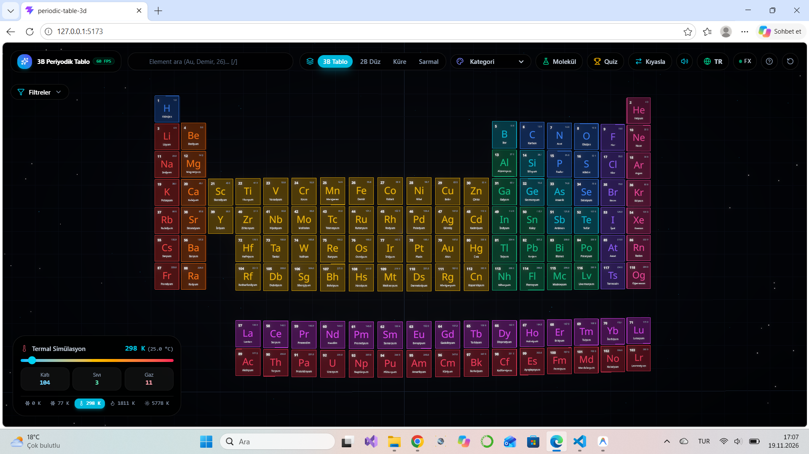
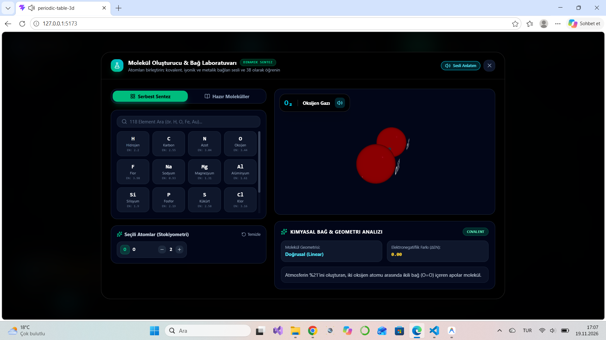
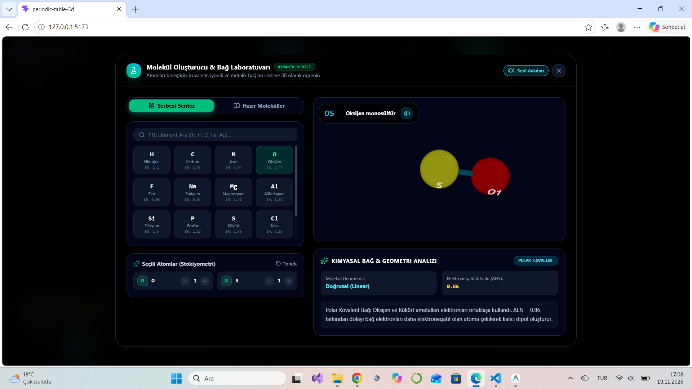
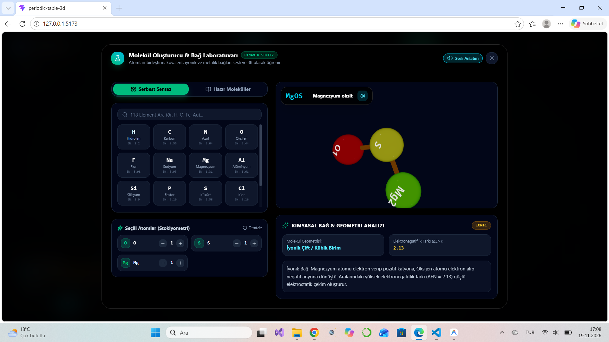
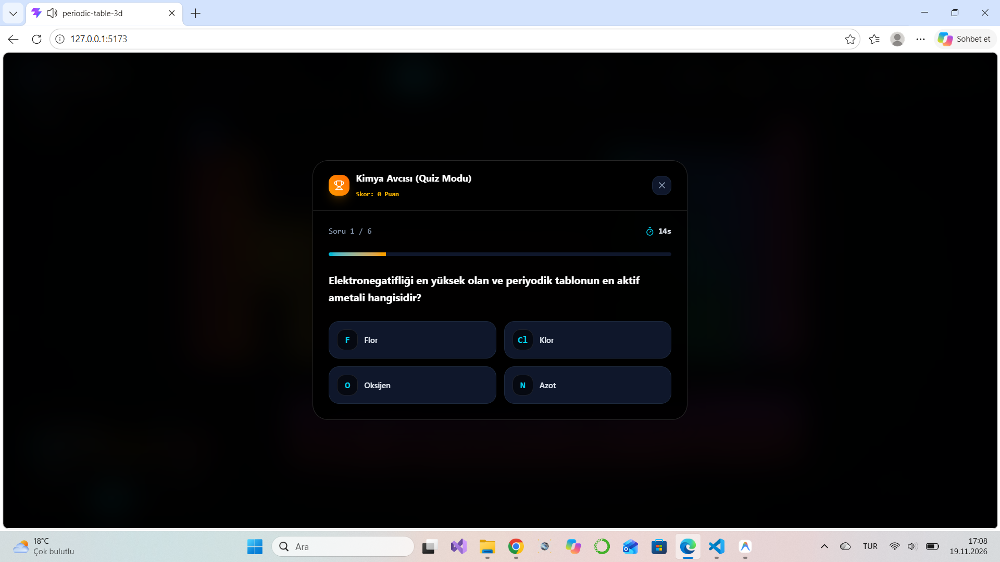
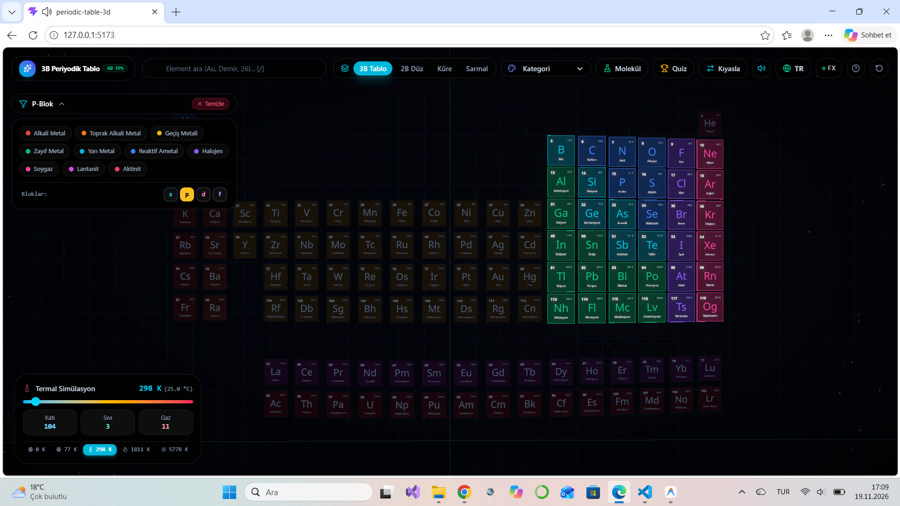
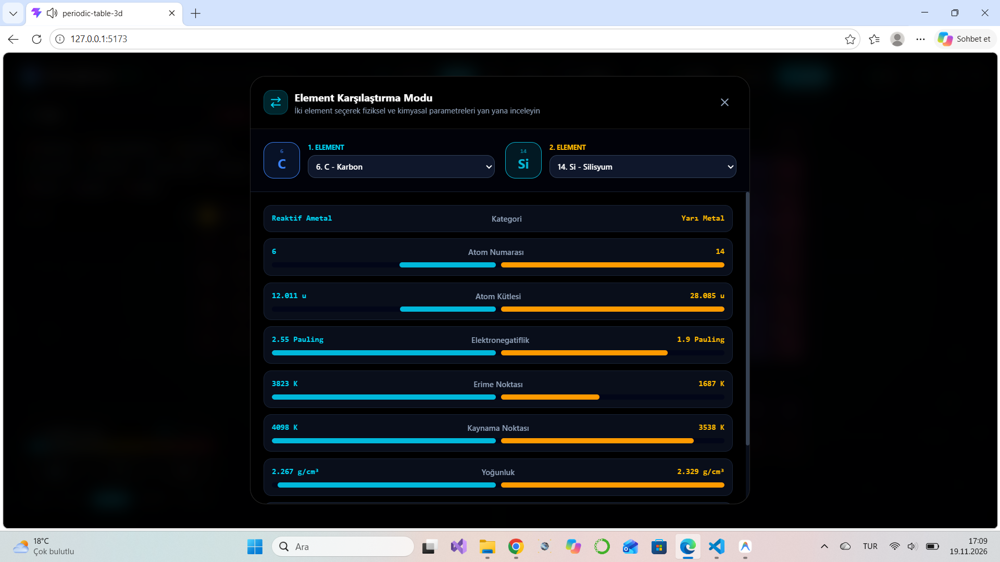

# 🧪 Etkileşimli 3 Boyutlu Periyodik Tablo & Kuantum Kimya Laboratuvarı

<div align="center">

[](https://react.dev/)
[](https://threejs.org/)
[](https://www.typescriptlang.org/)
[](https://vitejs.dev/)
[](https://tailwindcss.com/)
[](https://vitest.dev/)
[](https://webglreport.com/)

**Modern WebGL, React Three Fiber ve Web Audio API ile geliştirilmiş, 118 elementin tamamını içeren bilim-kurgu estetiğinde üretim kalitesinde 3D interaktif kimya simülasyonu.**

[English Documentation (README_EN.md)](./README_EN.md) • [Canlı Önizleme](#-hızlı-başlangıç) • [Özellikler](#-temel-özellikler) • [Mimari](#-mimari-ve-teknoloji-yığını)

</div>

---

## 📸 Ekran Görüntüleri Galerisi

<div align="center">

### 🌌 1. Karanlık Obsidyen 3D Periyodik Tablo & Uzaysal Düzen

*118 element, füme cam kartlar (`#060913`), neon kenar ışıması, dinamik 3D hover/tilt ve parçacık alanı.*

---

### 🧬 2. Detaylı Bilgi Kartı & 3D Gerçek Fiziksel Numune

*Genişletilmiş atomik veriler (Proton, Nötron, Elektron, Oksidasyon, Yarıçap, İyonlaşma) ve 3B metalik altın külçesi.*

---

### 💎 3. 3D Kristal Kafes Birim Hücre Görüntüleyici

*FCC (Yüzey Merkezli Kübik), BCC, HCP ve Elmas birim hücreleri; koordinasyon sayısı ve doluluk oranı.*

---

### 🌈 4. Optik Işıma Spektrumu & Fraunhofer Analizörü

*Dan Bruton CIE algoritması ile 380-750 nm dalga boyundan tam renk dönüşümü, foton enerjisi (eV) ve plazma tüpü ışıması.*

---

### ☢️ 5. 3D Radyoaktif Bozunma & İzotop Simülatörü

*Alfa ($^4_2He$), Beta ($e^-$) ve Gama ($\gamma$) ışıması parçacık fırlatma animasyonu, kız çekirdeğe dönüşüm ve Geiger sayacı.*

---

### 🧪 6. Molekül Oluşturucu & Serbest Sentez Bağ Sandbox'ı

*Atomları serbestçe birleştirme ($O_2, H_2O, CO_2, NaF$ vb.), VSEPR 3D top-çubuk modeli, kovalent/iyonik bağ analizi ve Türkçe seslendirme.*

---

### 🎮 7. Kimya Avcısı / Gamified Quiz Modu

*15 saniyelik süreli soru bankası, kombo puanlama, 3D masada elementi bulma ve Nobel Kimyageri başarı rozetleri.*

</div>

---

## 🌟 Temel Özellikler

### 1. 🌌 3D Periyodik Tablo ve Uzaysal Düzen Motoru
- **118 Kimyasal Element**: Hidrojen'den (1) Oganesson'a (118) kadar tüm elementler eksiksiz yerel veritabanında (`elements.json`). Sıfır harici API bağımlılığı.
- **4 Farklı Dinamik Uzaysal Düzen**:
  - **3B Tablo (`table`)**: Klasik IUPAC periyodik tablo düzeni, sinematik derinlik kavislenmesi, Lantanit ve Aktinitler altta.
  - **2B Düz (`flat`)**: Dik açılı, tam düz ve okunaklı grid görünümü.
  - **Küre Düzeni (`sphere`)**: Altın oran Fibonacci küre dağılımı ile 360° uzay kafesi.
  - **Sarmal Düzen (`helix`)**: Atom numarasına göre yükselen silindirik helezon sarmalı.
- **Dinamik 3D Kart Etkileşimi**: Fare ile üzerine gelinen element öne doğru yükselir, imleç konumuna göre pürüzsüzce eğilir (tilt).

### 2. ⚛️ Etkileşimli 3D Atom Modeli & Gerçek Fiziksel Numune
- Bir elemente tıklandığında kamera sinematik yumuşak bir geçişle (ease lerp) elementin yanına uçar.
- **4 Farklı 3B İnceleme Modu**:
  1. **Bohr Modeli**: Elementin gerçek elektron kabuk katmanlarına (`shells`) göre bağımsız dönen yörüngeler ve fotonik elektronlar.
  2. **Kuantum Olasılık Bulutu**: Elektron olasılık yoğunluğu orbital bulutu.
  3. **3B Gerçek Fiziksel Numune**: Altın/Bakır için metalik külçeler, Karbon/Kükürt için kristal yapılar, Cıva/Brom için sıvı damlacıkları, Soygazlar için plazma deşarj tüpü.
  4. **3B Kristal Kafes**: FCC, BCC, HCP ve Elmas birim hücre kafesleri.
- **LOD (Level of Detail) Nükleon Simülasyonu**: $Z > 24$ olan ağır elementlerde çekirdek 30 optimize nükleona sabitlenir, 60 FPS performansı korunur.

### 3. 🧪 Molekül Oluşturucu & Serbest Sentez Bağ Sandbox'ı
- **Serbest Sentez Laboratuvarı**: Element havuzundan veya 118 element arama kutusundan istediğiniz atomları seçip birleştirin.
- **Dinamik Bağ ve Formül Motoru**:
  - Örneğin iki oksijen ($O + O$) koyduğunuzda anında **$O_2$ (Dioksijen / Oksijen Gazı)** olarak tanır.
  - Pauling elektronegatiflik farkına ($\Delta EN$) göre **Apolar Kovalent İkili Bağ (:O=O:)** teşhisini koyar.
  - $Na + F$ birleştiğinde **$NaF$ (Sodyum Florür)** iyonik bağ analizi üretir.
  - Soy gazlar eklendiğinde kimyasal bağ yapmayacağını açıklar.
- **VSEPR 3D Top-Çubuk Modeli**: Oluşan molekül uzayda gerçek bağ açıları (Kırık Doğru 104.5°, Doğrusal 180°, Dörtyüzlü 109.5° vb.) ve silindir bağlarla 3D modellenir.
- **Türkçe Sesli Anlatım (Web Speech API)**: Oluşturulan molekülün adını ve bağ türünü tarayıcının yerel sentezleyicisiyle Türkçe seslendirir.

### 4. 🌈 Optik Işıma Spektrumu & Fraunhofer Analizörü
- 118 elementin optik emisyon çizgileri veritabanı (380 nm - 750 nm).
- **Dan Bruton CIE Algoritması**: Dalga boyunu sRGB renge dönüştürür.
- İnteraktif spektrum şeridinde çizgilere gelinerek dalga boyu (nm), foton enerjisi (eV) ve bağıl ışıma şiddeti incelenebilir.
- Elementin gaz deşarj tüpündeki entegre plazma rengi gösterilir.

### 5. 💎 3D Kristal Kafes Yapısı Görüntüleyici
- Elementlerin katı haldeki birim hücre (unit cell) geometrisi:
  - **FCC (Yüzey Merkezli Kübik)**: Au, Ag, Cu, Pt, Al, Pb
  - **BCC (Hacim Merkezli Kübik)**: Fe, Cr, W, Na, K
  - **HCP (Hekzagonal Sıkı Paket)**: Ti, Zn, Mg, Co
  - **Elmas Kübik**: C (Elmas), Si, Ge
- Koordinasyon sayısı (Coordination Number) ve paketleme doluluk oranı (Packing Efficiency).

### 6. ☢️ İzotoplar ve 3D Radyoaktif Bozunma Simülatörü
- Elementlerin kararlı ve radyoaktif izotopları, doğal bolluk oranları, yarılanma ömürleri ($t_{1/2}$) ve bozunma modları.
- **3D Parçacık Patlaması**: $\alpha$ ($^4_2He$ nükleonu), $\beta^-$ (yüksek enerjili elektron) ve $\gamma$ foton dalgası parçacık animasyonu ile çekirdekten fırlatma ve kız çekirdeğe dönüşüm simülasyonu.

### 7. 🔊 Fütüristik Web Audio API Ses Motoru
- Sıfır dış kütüphane bağımlılığı (Saf AudioContext).
- Kartların üzerine gelindiğinde atom numarasına ($Z$) göre frekans modülasyonlu kuantum rezonansı, kristal seçim tonları, kamera geçiş sesi ("whoosh"), Geiger sayacı klikleri ve sentez akorları.
- Üst çubukta Mute/Unmute butonu.

### 8. 🎮 Kimya Avcısı / Gamified Quiz Modu
- 15 saniyelik süreli soru bankası, kombo çarpanı ve puanlama.
- Doğru/yanlış sesli ve görsel neon geri bildirimi.
- Sorulan elementi anında 3B masada inceleme bağlantısı (`Inspect in 3D`).
- Skor ekranı ve başarı rozetleri (Nobel Kimyageri, Kuantum Fizikçisi, Çaylak Simyacı).

### 9. 🌡️ Termodinamik Sıcaklık Simülatörü
- **0 K ile 6000 K** arası canlı termodinamik durum motoru.
- Sıcaklık değiştikçe erime ve kaynama noktaları kıyaslanarak elementlerin faz durumu (Katı, Sıvı, Gaz) ve renkleri sıfır gecikmeyle güncellenir.
- Hızlı ayar presetleri: Mutlak Sıfır (0 K), Sıvı Azot (77 K), Oda Sıcaklığı (298 K), Demir Erimesi (1811 K), Güneş Yüzeyi (5778 K).

---

## 🛠️ Mimari ve Teknoloji Yığını

| Katman | Teknoloji | Açıklama |
| :--- | :--- | :--- |
| **Framework** | React 19 + TypeScript (Strict) | Tip güvenli bileşen mimarisi, `verbatimModuleSyntax` |
| **3D Grafik Motoru** | Three.js, `@react-three/fiber`, `@react-three/drei` | WebGL canvas, shaderlar, prosedürel geometriler |
| **Post-Processing** | `@react-three/postprocessing`, `postprocessing` | Unreal Bloom, Vignette, donanım FX/PERF toggle |
| **State Yönetimi** | Zustand | Tek yönlü, reaktif küresel durum yönetimi |
| **Arayüz & Animasyon** | Tailwind CSS v4, Lucide React | Füme cam (Glassmorphism), neon kenarlar |
| **Ses & Konuşma** | Web Audio API + Web Speech API | Dahili sentezleyici, sıfır harici paket |
| **Test Motoru** | Vitest | 26/26 birim testi (veri bütünlüğü, dalga boyu, molekül motoru) |

---

## ⚡ Hızlı Başlangıç

### Gereksinimler
- Node.js (v18 veya üzeri önerilir)
- npm veya pnpm

### Kurulum ve Çalıştırma

```bash
# Depoyu klonlayın
git clone https://github.com/YusufKoc05/periodic-table-3d.git
cd periodic-table-3d

# Bağımlılıkları yükleyin
npm install --legacy-peer-deps

# Geliştirme sunucusunu başlatın
npm run dev

# Tarayıcınızda açın
# http://localhost:5173
```

### Test ve Derleme

```bash
# 26 adet Vitest birim testini çalıştırın
npm test

# Üretim derlemesi alın (Production Build)
npm run build
```

---

## ⌨️ Klavye Kısayolları

| Tuş | İşlev |
| :---: | :--- |
| `/` | Anında arama çubuğuna odaklan |
| `ESC` | Seçili elementi veya aktif modalı kapat |
| `←` / `→` | Önceki / Sonraki elemente geç |
| `C` | İki elementi yan yana karşılaştırma modunu aç/kapat |
| `1` - `4` | 3B Tablo, 2B Düz, Küre ve Sarmal düzenler arası geçiş |
| `Space` | 3D atom modelinin dönüşünü durdur / başlat |
| `?` | Klavye kısayolları penceresini aç |

---

## 📄 Lisans

Bu proje [MIT Lisansı](LICENSE) kapsamında açık kaynak olarak sunulmaktadır.

Geliştirici: **[Yusuf Koç](https://github.com/YusufKoc05)**
