# 🧪 Interactive 3D Periodic Table & Quantum Chemistry Laboratory

<div align="center">

[](https://react.dev/)
[](https://threejs.org/)
[](https://www.typescriptlang.org/)
[](https://vitejs.dev/)
[](https://tailwindcss.com/)
[](https://vitest.dev/)
[](https://webglreport.com/)

**Production-grade, sci-fi aesthetic interactive 3D chemistry laboratory featuring all 118 chemical elements, powered by React 19, Three.js, WebGL shaders, and the Web Audio API.**

[Türkçe Dokümantasyon (README.md)](./README.md) • [Live Preview](#-quick-start) • [Features](#-key-features) • [Architecture](#-architecture--tech-stack)

</div>

---

## 📸 Screenshots Gallery

<div align="center">

### 🌌 1. Dark Obsidian 3D Periodic Table & Spatial Layouts
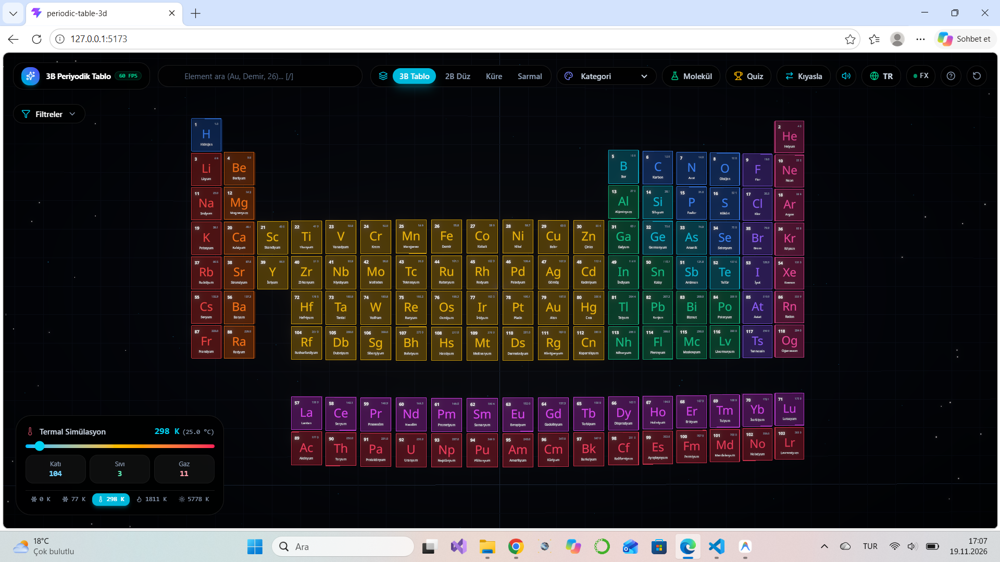
*All 118 elements, smoked frosted glass cards (`#060913`), vibrant neon edge glow, dynamic 3D tilt/lift, and cosmic particle field.*

---

### 🧬 2. Element Detail Card & 3D Physical Specimen
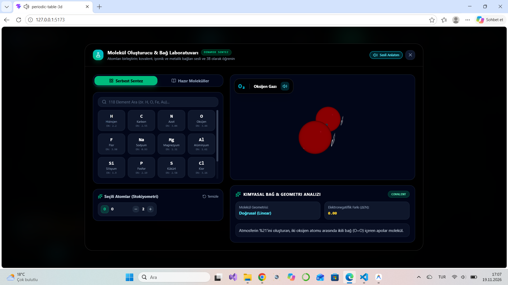
*Comprehensive atomic matrix (Protons, Neutrons, Electrons, Oxidation states, Radii, Ionization) and real physical sample (Gold nugget).*

---

### 💎 3. 3D Crystal Lattice Unit Cell Viewer
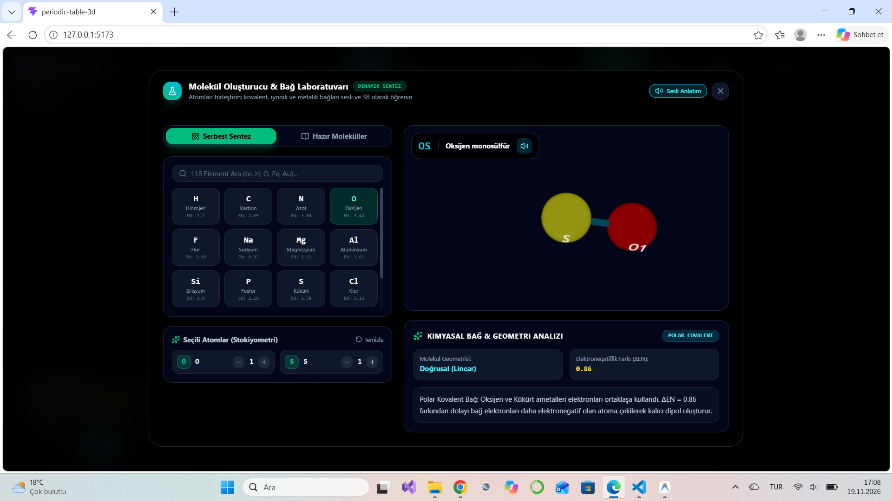
*FCC (Face-Centered Cubic), BCC, HCP, and Diamond unit cells with coordination number and packing efficiency metrics.*

---

### 🌈 4. Optical Emission Spectrum Analyzer
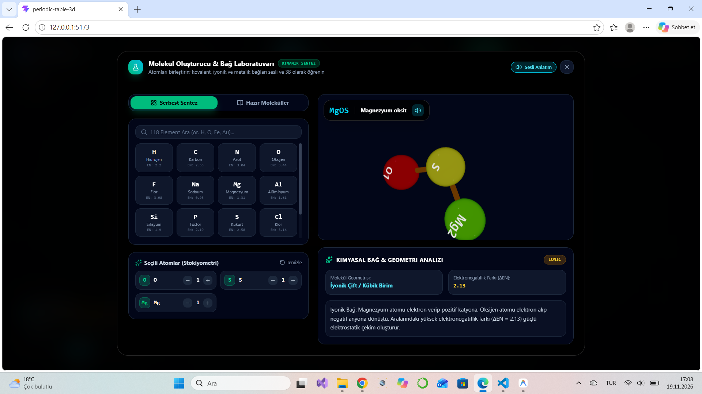
*Dan Bruton CIE physics algorithm translating 380–750 nm spectral lines into true sRGB colors, photon energies (eV), and discharge tube plasma.*

---

### ☢️ 5. 3D Radioactive Decay & Isotope Simulator
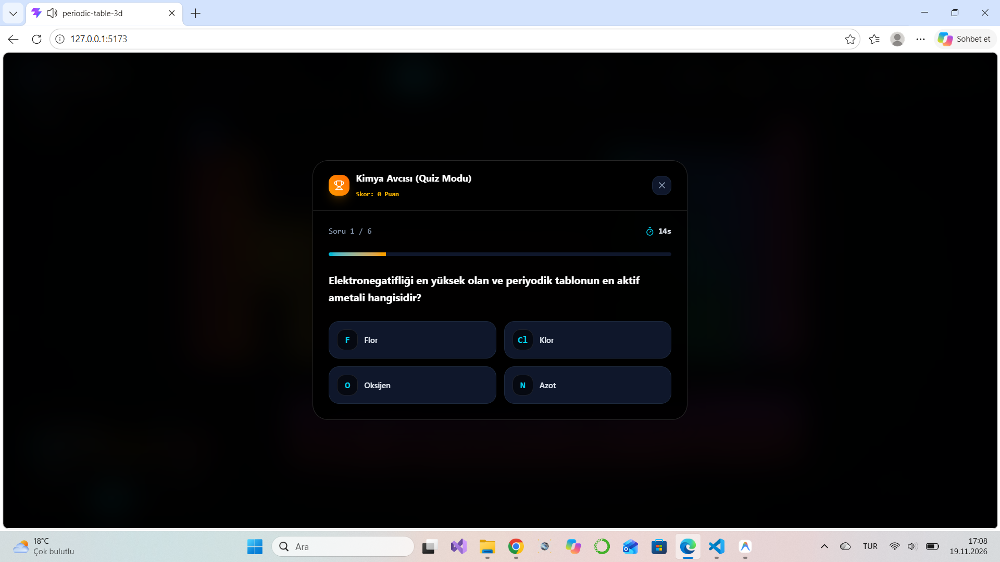
*Alpha ($^4_2He$), Beta ($e^-$), and Gamma ($\gamma$) particle ejection animations with daughter nucleus transmutation and Geiger counter acoustics.*

---

### 🧪 6. Compound Builder & Chemical Bonding Sandbox
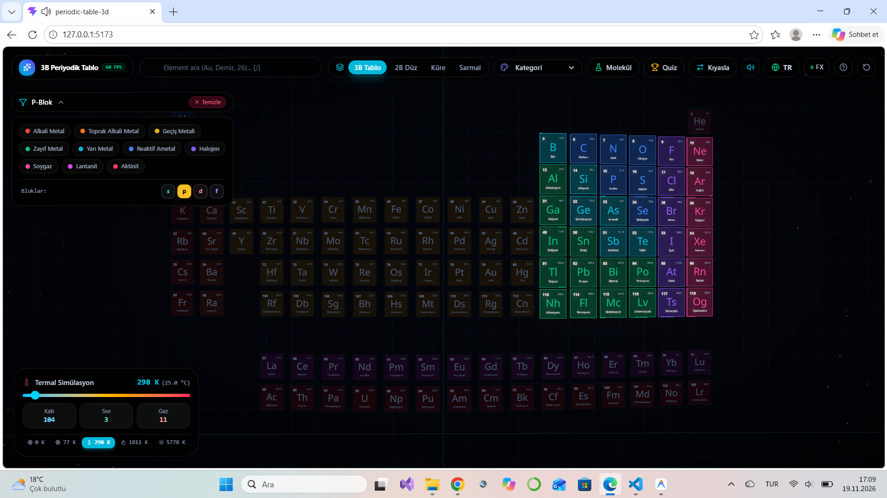
*Freely combine atoms ($O_2, H_2O, CO_2, NaF$, etc.), interactive VSEPR 3D ball-and-stick models, covalent/ionic classification, and speech narration.*

---

### 🎮 7. Chemistry Hunter / Gamified Quiz Mode
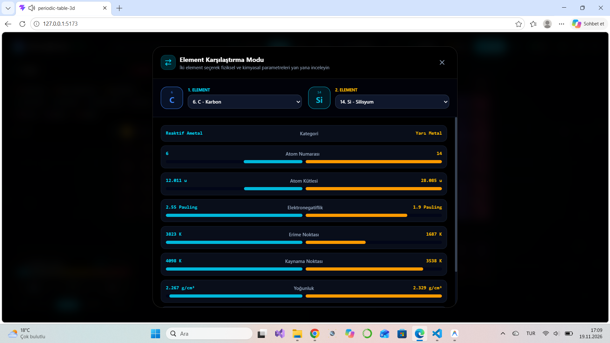
*15-second timed quiz questions, combo multipliers, instant 3D table inspection, and Nobel Chemist achievement titles.*

---

### 🔬 8. Detailed Atomic & Chemical Properties Matrix
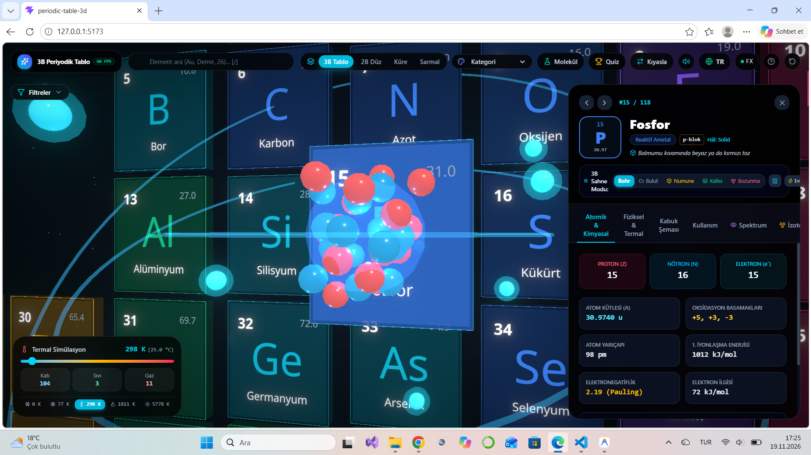
*Proton, neutron, and electron counts, oxidation states, atomic radii, ionization energy, and electron affinity.*

---

### 🌈 9. High-Precision Optical Emission Spectrogram
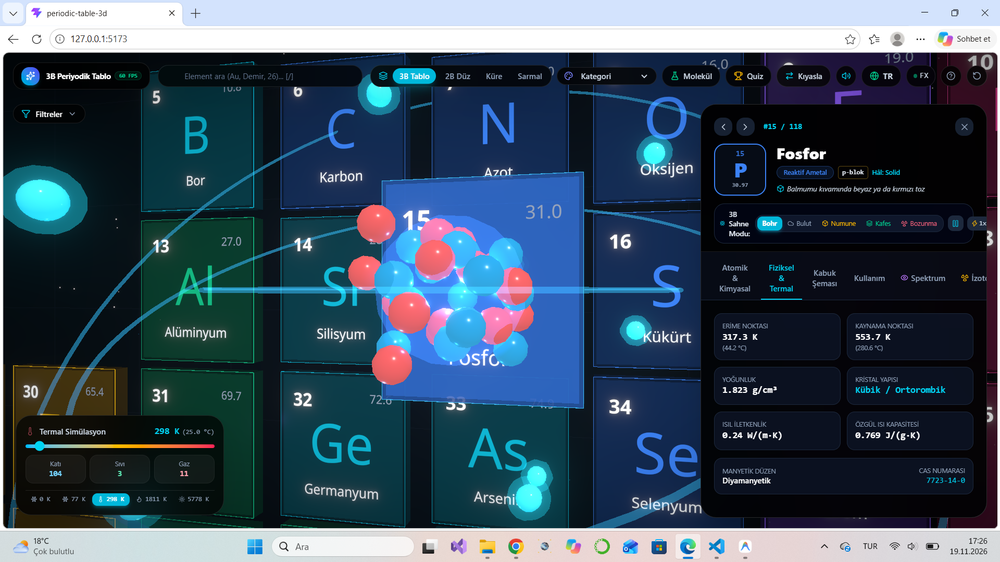
*Specific emission lines from 380 to 750 nm, discharge tube plasma chromaticity, and photon energy metrics.*

---

### ☢️ 10. Isotopes & Radioactivity Analysis
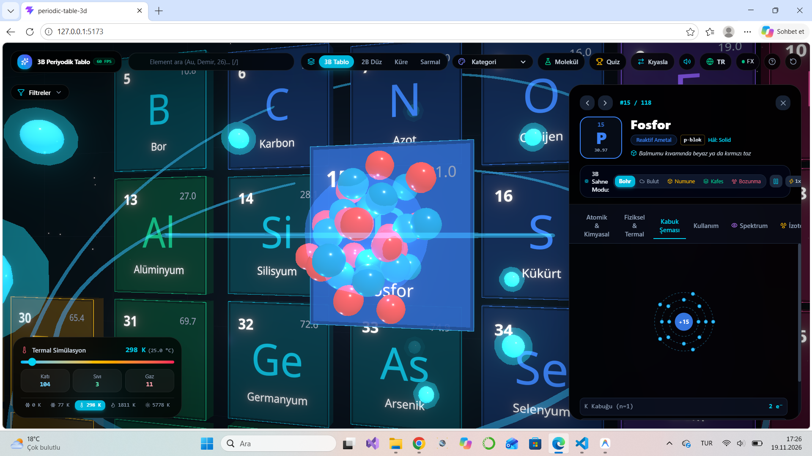
*Comprehensive list of stable and radioisotopes, natural abundances, half-lives, and decay classification.*

---

### 💎 11. Solid-State Crystal Lattice Viewer
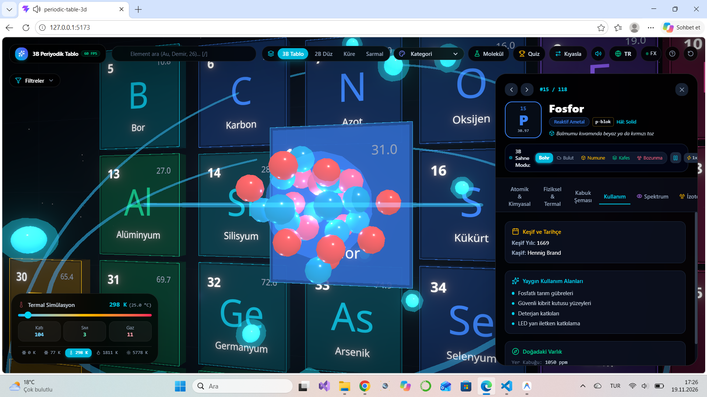
*3D unit cells (FCC, BCC, HCP, Diamond) showing spatial atomic coordination in the solid state.*

---

### ⭕ 12. Electron Shell Orbital Diagram (Bohr Rings)
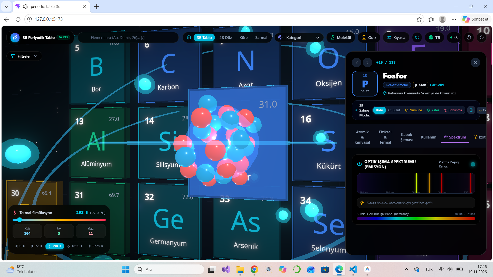
*Vector SVG orbital diagram depicting electron population across K, L, M, N, O, P, Q shells.*

---

### 📜 13. Discovery History & Industrial Applications
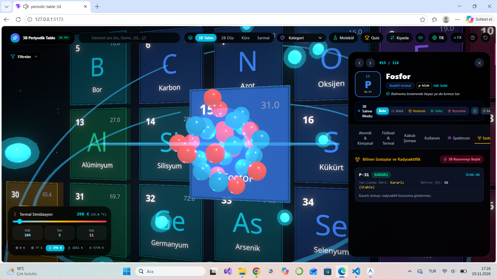
*Discovery year, discoverers, modern industrial applications, and planetary/cosmic abundance ratios.*

</div>

---

## 🌟 Key Features

### 1. 🌌 3D Periodic Table & Spatial Layout Engine
- **Complete 118 Element Dataset**: Full local database (`elements.json`) from Hydrogen (1) to Oganesson (118). Zero external API dependencies.
- **4 Dynamic Spatial Layouts**:
  - **3D Table (`table`)**: Classical IUPAC arrangement with curved depth, separating Lanthanides and Actinides.
  - **2D Flat (`flat`)**: Orthographic, crisp, readable grid view.
  - **Spherical Layout (`sphere`)**: Fibonacci golden-ratio spherical shell in 360° space.
  - **Helix Layout (`helix`)**: Cylindrical ascending spiral ordered by atomic number.
- **Dynamic 3D Hover & Tilt**: Mouse-over elevates the card with smooth physical perspective tilt.

### 2. ⚛️ Interactive 3D Atom & Real Specimen Models
- Clicking an element triggers a cinematic ease-in camera flight to focus on the atom.
- **4 Distinct 3D Inspection Modes**:
  1. **Bohr Model**: Independently rotating electron shells with glowing electrons matched to true configuration.
  2. **Quantum Cloud**: Orbital probability density cloud.
  3. **Real Physical Specimen**: Gold/Copper metallic nuggets, Carbon/Sulfur crystals, Mercury/Bromine droplets, Noble gas discharge tubes.
  4. **Crystal Lattice**: FCC, BCC, HCP, and Diamond unit cell wireframes.
- **LOD (Level of Detail) Nucleon Engine**: For heavy atoms ($Z > 24$), nucleus particles optimize to 30 nucleons to guarantee silky smooth 60 FPS.

### 3. 🧪 Compound Builder & Free Synthesis Bonding Sandbox
- **Free Synthesis Mode**: Pick any atoms from the reactant palette or search through all 118 elements.
- **Automated Bonding & Nomenclature Engine**:
  - Combining two oxygens ($O + O$) dynamically yields **$O_2$ (Dioxygen / Oxygen Gas)**.
  - Automatically diagnoses **Non-polar Covalent Double Bond (:O=O:)** based on $\Delta EN = 0.00$.
  - Combining $Na + F$ yields **Sodium Fluoride ($NaF$)** with ionic transfer analysis.
  - Noble gases trigger an alert explaining their inert octet/duplet stability.
- **VSEPR 3D Ball-and-Stick Models**: Live rendering of molecular geometry (Bent 104.5°, Linear 180°, Tetrahedral 109.5°, etc.).
- **Speech Synthesis Narration (Web Speech API)**: Speaks the synthesized molecule name and bonding characteristics.

### 4. 🌈 Optical Emission Spectrum Analyzer
- Optical emission lines database for elements across the visible spectrum (380–750 nm).
- **Dan Bruton CIE Color Algorithm**: Converts wavelength to true sRGB color with gamma correction.
- Interactive inspector provides wavelength (nm), photon energy (eV), and relative intensity.
- Gas discharge tube integrated plasma color glow.

### 5. 💎 3D Crystal Lattice Unit Cell Viewer
- Unit cell geometries for solid-state elements:
  - **FCC (Face-Centered Cubic)**: Au, Ag, Cu, Pt, Al, Pb
  - **BCC (Body-Centered Cubic)**: Fe, Cr, W, Na, K
  - **HCP (Hexagonal Close-Packed)**: Ti, Zn, Mg, Co
  - **Diamond Cubic**: C (Diamond), Si, Ge
- Computes coordination number and atomic packing efficiency.

### 6. ☢️ Isotopes & 3D Radioactive Decay Simulator
- Stable and radioactive isotopes database, abundance percentages, half-lives ($t_{1/2}$), and decay modes.
- **3D Particle Emission**: Ejection of $\alpha$ particles, high-speed $\beta^-$ electrons, and expanding $\gamma$ shockwaves with daughter transmutation.

### 7. 🔊 Futuristic Web Audio API Sound Engine
- Zero external audio libraries (Pure browser AudioContext).
- Quantum harmonic hover blips tuned to atomic number ($Z$), crystal selection chimes, layout transition whooshes, Geiger counter ticks, and reaction fanfare chords.
- Mute/Unmute toggle on the top toolbar.

### 8. 🎮 Chemistry Hunter / Gamified Quiz Mode
- 15-second countdown questions, combo multiplier, and score tracker.
- Inspect answered element directly in the 3D table.
- Achievement ranks: Novice Alchemist, Quantum Researcher, Nobel Laureate.

### 9. 🌡️ Thermodynamic Temperature Simulation
- Live thermal phase engine spanning **0 K to 6000 K**.
- Real-time phase calculation (Solid, Liquid, Gas) and live counters (e.g. at 298 K: 104 Solids, 3 Liquids, 11 Gases).
- Quick presets: Absolute Zero (0 K), Liquid Nitrogen (77 K), Room Temp (298 K), Iron Melting (1811 K), Solar Surface (5778 K).

---

## 🛠️ Architecture & Tech Stack

| Layer | Technology | Details |
| :--- | :--- | :--- |
| **Framework** | React 19 + TypeScript (Strict) | Type-safe modular architecture with `verbatimModuleSyntax` |
| **3D Engine** | Three.js, `@react-three/fiber`, `@react-three/drei` | WebGL canvas, shaders, procedural geometry generation |
| **Post-Processing**| `@react-three/postprocessing`, `postprocessing` | Unreal Bloom, Vignette with hardware FX/PERF toggle |
| **State Management**| Zustand | Single-direction reactive store |
| **UI & Styling** | Tailwind CSS v4, Lucide React | Smoked glassmorphism, neon edge borders |
| **Audio & Speech** | Web Audio API + Web Speech API | Native synthesis, zero bundle bloat |
| **Test Suite** | Vitest | 26/26 unit tests covering data integrity and physics math |

---

## ⚡ Quick Start

### Prerequisites
- Node.js (v18 or higher recommended)
- npm or pnpm

### Installation

```bash
# Clone the repository
git clone https://github.com/YusufKoc05/periodic-table-3d.git
cd periodic-table-3d

# Install dependencies
npm install --legacy-peer-deps

# Start development server
npm run dev

# Open in browser
# http://localhost:5173
```

### Verification & Testing

```bash
# Run all 26 Vitest unit tests
npm test

# Produce production build
npm run build
```

---

## ⌨️ Keyboard Shortcuts

| Key | Action |
| :---: | :--- |
| `/` | Focus search bar immediately |
| `ESC` | Close selected element card or open modal |
| `←` / `→` | Navigate to previous / next element |
| `C` | Toggle element comparison mode |
| `1` – `4` | Switch spatial layouts (3D Table, Flat, Sphere, Helix) |
| `Space` | Pause / resume 3D atom spin |
| `?` | Open keyboard shortcuts help modal |

---

## 📄 License

This project is licensed under the [MIT License](LICENSE).

Developer: **[Yusuf Koç](https://github.com/YusufKoc05)**
